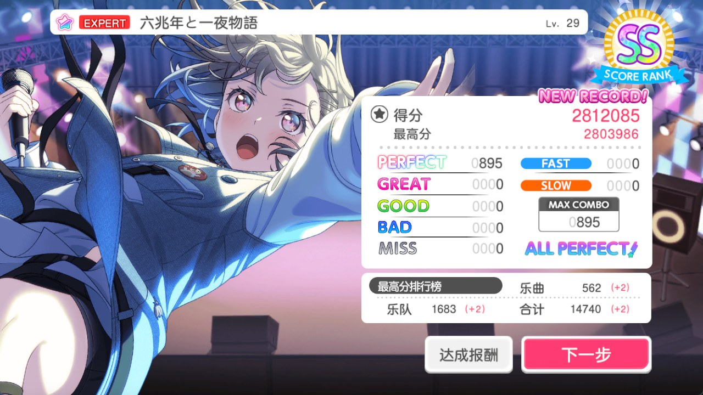
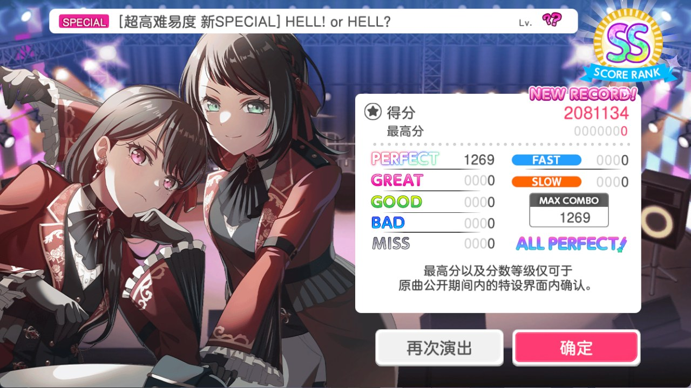
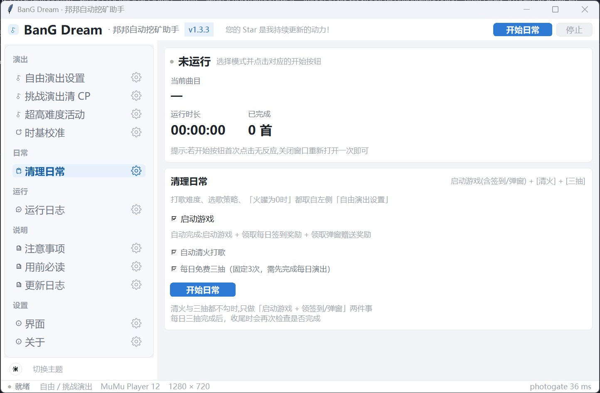
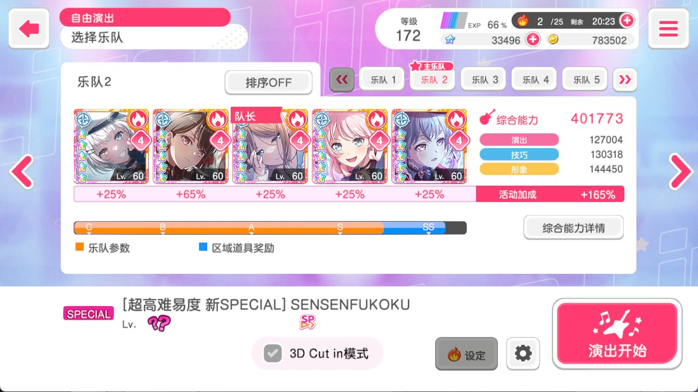

<div align="center">

# BanG Dream · Auto-Play Mining Helper

Auto-play script for BanG Dream! (Chinese server) + GUI launcher

    

> Keywords: BanG Dream / auto-play / auto-mining / script / emulator / MuMu / autodori

</div>

> This document is a translation of [README.md](README.md). If the two disagree, the Chinese version wins.

## ✨ Features

- [x] **A more modern-looking GUI**: **Maa/SukiUI style** — custom-drawn widgets with left sidebar navigation, card-based settings, always-on run status and current song, light/dark themes, font scaling
- [x] **Daily cleanup**: launches the game, claims the daily login reward, claims popup gift rewards, **auto-clears live boost by playing** and runs the **3 free daily pulls**
- [x] **Multiple song-selection strategies**: **mining-oriented**, **random**
- [x] **"SPECIAL extra-high difficulty event" support**: walk to the "Select Band" screen in game manually, the script takes over the start, plays that one fixed chart and stops — no loop (see the dedicated section below)
- [x] **Challenge Live CP clearing**: started separately from the GUI, it picks 8x / 4x / 2x / 1x based on your balance each song and stops when less than 200 CP is left
- [x] **GUI launcher**: difficulty / song-selection strategy / boost strategy / photogate / life-exhausted strategy
- [x] **Automatic photogate calibration**: after each song the timing is nudged from the FAST/SLOW distribution and converges within a few songs — no manual tuning needed on a different PC
- [x] **Auto select song, auto play, and re-play after the result screen**: handles PT reward popups, character dialogue, failed lives, event stories and the rest of the result flow
- [x] When life is exhausted you can choose **auto-exit and re-select a song** or **wait for manual action**; when boost is 0 you can choose **stop on the game home screen**, **keep mining** (playing at 0 boost, no rewards) or **exit the game**
- [x] **Emulator compatibility**: MuMu 12 / MuMu V5 / LDPlayer (MuMu recommended); pick which MuMu multi-instance to use

**Proof is in the pudding! 👇**





**SPECIAL extra-high difficulty event:**



## 🖥 GUI (Maa/SukiUI style)

- Top **app bar**: app name, version number, start/stop buttons; the light/dark theme switch sits at the bottom of the left sidebar and the font size lives under **Settings → Interface**
- **Persistent run card**: status indicator, **current song**, elapsed time, songs finished, start/stop buttons
- **Left navigation**: Live (Free Live settings / Challenge Live CP / SPECIAL event / Timing calibration), Daily cleanup, Run log, Docs (Notes / Before you start / Update log), Settings (Interface / About)
- **A single start entry**: **Start Daily**. The old standalone "Start Free Live" overlapped with it (same song picking / difficulty / boost logic) and has been merged into it; difficulty, song-selection strategy and the zero-boost strategy all live under **Free Live settings**
- **Run log**: key events only; open log folder / export the full log / clear; logs older than 7 days are removed automatically on startup
- Settings are persisted in `data/gui_config.json` (theme / font size / window / current page, ...)



## 🎯 Challenge Live CP clearing

1. In game, pick your challenge song and team and stop on the challenge song-select screen.
2. Start the GUI and go to **Challenge Live CP** in the left sidebar, pick a difficulty (HARD by default).
   For multi-instance setups, pick the target instance under "Emulator instance" on that page — the setting is shared with **Start Daily**.
3. Choose "exit the game after CP is cleared": checked = exit the game, unchecked = go back to the home screen. Then click **Start CP clearing**.

Before every song the balance is read again and the CP ratio is set to the highest one you can pay:

| CP balance | Ratio | Cost |
| --- | --- | --- |
| ≥ 1600 | 8x | 1600 CP |
| 800–1599 | 4x | 800 CP |
| 400–799 | 2x | 400 CP |
| 200–399 | 1x | 200 CP |
| < 200 | stop | 0 CP |

Challenge Live does not check LIVE BOOST, it repeats the current song and is not affected by the mining song-selection strategy.
It stops when the CP value cannot be recognized or when the consumption after setting does not match the chosen ratio. Click **Stop** to end it manually.
The action after CP clearing runs only when the balance is confirmed to be below 200 CP. On the command line use `--challenge-finish home` (default) or `--challenge-finish exit`.

For a local source checkout, double-click `run_gui_src.bat` to make sure the modified GUI is used. On the command line you can also run:

```powershell
.venv\Scripts\python.exe src\autodori.py --livemode challengelive --difficulty hard --skip-version-check
```

## 🎯 SPECIAL extra-high difficulty event (limited-time single song)

**Steps:**

1. In game, walk manually to the **"Select Band"** screen — pick your band and stop on the page whose **bottom-right corner has the "Start Live" button**
2. Back in the GUI, go to the **SPECIAL event** page in the left sidebar, pick the song and click **Start (SPECIAL event)** at the bottom
3. The script taps the start button and plays the chart by itself; **after the song it stays on the result screen and does not continue to the next one**

The game must be left on this page, from where the script takes over:



**Note:**

- The **difficulty of the event song is fixed to SPECIAL by the event**; difficulty / song-selection strategy / boost strategy and the other options on the Free Live settings page have no effect in this mode
- The **Start Daily** button in the **top-right corner** of the GUI runs the regular live flow and has nothing to do with the SPECIAL event page
- If the song you want is not in the dropdown, add it to `SPECIAL_SONGS` in `gui.py` using the Simplified Chinese client title (a Bestdori song id also works)

## 🛠 Requirements (important, otherwise playing will not work properly)

### Emulator settings
- Use MuMu Player 12, resolution **1280x720**, Vulkan rendering
- **Keep the frame rate high, do not cap it at 30fps**
- **Uncheck "Disable Android system sound"** (MuMu settings → Device → Sound) — leaving it checked shifts the whole timing earlier and causes heavy FAST; run with it off and everything is normal
- Try not to use the PC while songs are playing, to avoid performance fluctuations

### Game settings
- Live settings: set the note speed to **8.0**
- Live effects · volume settings: turn **"3D cut-in mode"** off and set **"action mode"** to **"light mode"**
- Live effects · volume settings: enable **"FAST/SLOW display"** and **"Perfect status display"**
- **Free Live** and **Challenge Live** are supported, co-op (Multi Live) is not

## 🚀 Usage

### Option 1: Standalone build (no Python needed, recommended for regular users)

1. Download `autodori_v1.x.x_Windows_X64.zip` from [Releases](https://github.com/1979711854/bangdream-autodori/releases) (the version number changes per release, e.g. `autodori_v1.3.3_Windows_X64.zip`)
2. Extract it to any folder
3. Double-click **`autodori_gui.exe`**
4. Pick difficulty and other parameters in the main window and click **Start Daily**

> The standalone build bundles the bot runtime (`autodori.exe` + `assets`), so it works right after extraction; the first run creates `data/` and `debug/` next to it. The exe files inside the archive are not affected by .gitignore and can be distributed directly.

### Option 2: From source (for developers / tuning your own parameters)

```bash
git clone https://github.com/1979711854/bangdream-autodori
cd bangdream-autodori
python -m venv .venv
.venv\Scripts\activate
pip install -r requirements.txt
python build.py          # organizes / downloads dependencies automatically
python gui.py            # start the GUI
# or run the bot directly on the command line:
python src/autodori.py --mode daily --difficulty expert
```

> To build, run `python build.py --version vX.Y.Z --os windows --arch amd64`; the artifacts land in `dist/` (assets and the version metadata are bundled).

## ❓ FAQ

**Q: Playing always comes out FAST, what should I do?**

A: First check whether "Disable Android system sound" under MuMu settings → Device → Sound is checked; if it is, uncheck it. If timing is still off, turn on **automatic photogate calibration** and play a few songs normally — it converges by itself.

**Q: Why can't the script play properly?**

A: Read the "Notes" page and README.md and check that your game and emulator settings are correct.

**Q: Why do some songs get lots of GREAT and MISS?**

A: A few charts are hard and the machine recognition may lag a bit. After the emulator has been running for a while, heat and memory pressure make touch input latency fluctuate and accuracy drop.

If almost every song gets too many GREAT, the photogate is usually misaligned. Open **automatic photogate calibration** on the main window and play a few songs normally — it converges by itself.


**Q: Is there a ban risk for using the script?**

A: A ban is possible, but as long as you do not use it for leaderboard boosting the odds are smaller.

**Q: How do I play one specific song?**

A: The code cannot target a specific song directly, but you can switch to the "Favourites" list manually,
add the songs you want to play to the in-game "Favourites" list and let the script pick only from there.

**Q: I found a bug?**

A: Please report it on GitHub Issues.

## ⚠️ Notes

1. The latest version of MuMu emulator is recommended; LDPlayer has been tested less and has performance issues.
2. This project is under active maintenance; you may still run into issues. Issues and PRs are welcome.
3. `data/config.yml` is now written by the GUI as **YAML**, and the bot side reads it with `yaml.safe_load` too.
   Edit it by hand as valid YAML — JSON is a subset of YAML and content exported by older versions still works;
   but do not get creative (unclosed quotes / tab indentation / full-width spaces): if it cannot be read the bot silently falls back to the defaults.


## 📌 Credits and provenance

This project is modified from the **GPLv3**-licensed [EvATive7/autodori](https://github.com/EvATive7/autodori). Thanks to the original author for the hard work and the open source spirit.

**What this version adds / changes compared to the original:**
- A brand-new **Maa/SukiUI style GUI** (custom-drawn widgets, left sidebar navigation, light/dark themes, always-on run status and current song)
- A new **SPECIAL extra-high difficulty event** mode (limited-time single song: stop on the "Select Band" screen manually, the script takes over the start and stops after that one song)
- Support for **FULL** songs
- Multiple song-selection strategies: **mining-oriented / random**
- Result-screen popup handling (PT rewards, character dialogue, failed lives, event stories)
- Life-exhausted strategies (auto-exit and re-select a song / wait for manual action) and a zero-boost strategy (stop on the home screen / keep mining / exit the game)
- An About page (author info, repository link) and per-stage daily progress in the run log
- Song entry merged into **Daily cleanup**; once the 3 daily pulls are confirmed, songs keep playing without returning to the home screen after each one
- Several popup / template fixes, plus log filtering and GUI preferences

**Under GPLv3, modifications and distribution in this repository must:**
- Keep the GPLv3 license (see [LICENSE](LICENSE))
- Credit the original author and source (this section serves that purpose)
- Share modifications as open source, commercial use is prohibited
- Note that this project is a modified fork, independent from the original project; please read this repository's README first


## 📝 Risks, use restrictions, disclaimers, licenses and copyrights

The original intention of this project is nothing more than an assistant, to make it easier for players to enjoy the game and progression. Using this project to harm fair play is prohibited. Please take care of the BanG Dream game environment and follow the game rules.

Please be aware that this project **must not be used for leaderboard boosting**. Officials always run secondary checks on boosting users; running in an emulator and unconventional input methods are high-risk factors, and using this project for leaderboards will almost certainly trigger a ban.

This project is released as open source and free of charge; commercial use or distribution by any individual or organisation is prohibited.

The developers and this project are not responsible for any direct or indirect losses caused by use or inability to use this project. Users must evaluate and assume all risks themselves.

This project is open source under the **GPLv3** license; follow the [project license](LICENSE) when modifying, copying or distributing it. This project is a fork of [EvATive7/autodori](https://github.com/EvATive7/autodori); when redistributing, keep the original author's attribution and the source notice (see "Credits and provenance" above) and keep the GPLv3 license.

This project also directly includes, modifies or distributes the following open source code, components or binaries:
- [minitouch ver.EvATive7](https://github.com/EvATive7/minitouch) (Apache License 2.0)
- [MaaFramework](https://github.com/MaaXYZ/MaaFramework) (LGPLv3)
